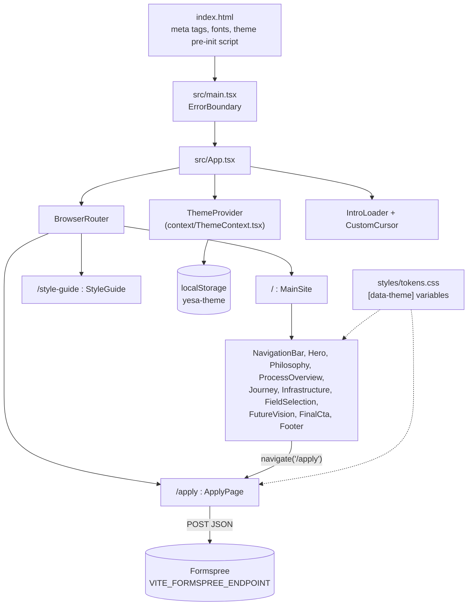

# Yesa-2

The second, redesigned version of the **YESA** website: a scroll-driven React landing site for a free incubator that guides people from application to leadership, with light and dark themes and a working online application form.

    

## Overview

YESA presents itself (see [`index.html`](index.html)) as *"a 100% free incubator designed to help people gradually develop into future leaders through structured real-world progression. Choose your field. We provide the path."*

The website's job is to make a long, multi-stage programme easy to understand and to turn interested visitors into applicants. It walks the visitor through the programme section by section and ends every section with a route to the application page:

| Stage | What the site says it means |
| --- | --- |
| Application | Profile intake |
| Interview | A two-way evaluation |
| Volunteering | Workflow immersion; an observation period alongside active cohorts |
| Paid internship | Compensated work in commercial sprints |
| Experienced | Squad leadership |
| World-class leader | The long-term aspiration |

Applicants choose one of four disciplines: **Agent Development**, **Design**, **Product**, and **Sales & Marketing**. Beyond the programme, the site describes two future pathways: contributing to initiatives built inside YESA ("Internal Squad"), or having YESA back and invest in a fellow's own venture ("Venture Backing").

### Relationship to YESA

[**YESA**](https://github.com/suriyaprakash-25/YESA) (25-26 Aug 2026) is the first version of this site; **Yesa-2** (28-29 Aug 2026) is its redesign. Both share the package name `yesa`, the page title and the section-based component structure. Compared with the first version, Yesa-2:

- replaces the front-end-only application modal with a dedicated `/apply` route that validates input and submits it to Formspree;
- adds React Router, light and dark themes, an intro loader, a custom cursor and an error boundary;
- replaces the five placeholder field tracks with four concrete disciplines;
- uses photography and roadmap images instead of purely abstract visuals, and adds the process overview and "What we do" sections.

## Key features

- **Three routes** (React Router 7): the landing page `/`, the application page `/apply`, and an internal design-system reference at `/style-guide`.
- **Light and dark themes**: the saved choice is read from `localStorage` (`yesa-theme`), falling back to the OS preference. An inline script in `index.html` applies the theme before React loads to avoid a flash of the wrong theme, and `ThemeContext` keeps following OS changes until the user picks a theme explicitly.
- **Landing page sections**: hero with background image, philosophy manifesto with comparison panels, process overview (the six stages with illustrations), the YESA Journey as a sticky stacked card deck, "What we do" (free trainings, experience-ship, industry leaders, global lecturers), discipline selection, future vision with an animated branching path, a final call to action and a footer.
- **Deep links to sections**: `/?section=<id>` scrolls to that section on load (ids: `philosophy`, `process-overview`, `what-we-do`, `fields`, `future`, `apply`).
- **Working application form** at `/apply`:
  - fields: full name, email, discipline, motivation (30-500 characters), optional phone and optional portfolio URL;
  - inline validation on blur and on submit;
  - `POST` as JSON to the Formspree endpoint from `VITE_FORMSPREE_ENDPOINT`, with loading, success and error states (Formspree error messages are surfaced to the user);
  - `/apply?discipline=<id>` pre-selects a discipline (`agent-development`, `design`, `product`, `sales-marketing`).
- **Polish**: a once-per-session intro loader (`sessionStorage`), a custom cursor shown only on devices with a fine pointer, scroll-linked animations with Framer Motion, Open Graph and Twitter meta tags, and a top-level React error boundary.
- **Design system**: shared primitives in [`src/components/core/`](src/components/core) and CSS variables for both themes in [`src/styles/tokens.css`](src/styles/tokens.css).

## Architecture

A purely client-side single-page application. The only external service is Formspree, which receives application submissions.



| Component | Role |
| --- | --- |
| `main.tsx` / `ErrorBoundary.tsx` | Mounts the app inside `StrictMode` and a class-based error boundary that catches render errors. |
| `App.tsx` | Wraps everything in `ThemeProvider` and `BrowserRouter`, renders the intro loader and custom cursor, defines the three routes, and composes the landing page (`MainSite`), including `?section=` deep-link scrolling. |
| `context/ThemeContext.tsx` | Theme state, persistence and OS-preference syncing; sets `data-theme` and the `dark` class on `<html>`. |
| `components/navigation/NavigationBar.tsx` | Floating capsule navigation with the theme toggle and the Apply button. |
| `components/hero/`, `philosophy/`, `journey/`, `fields/`, `future/`, `footer/` | One folder per landing-page section. |
| `pages/ApplyPage.tsx` | Application form, validation and Formspree submission. |
| `pages/StyleGuide.tsx` | Internal page that renders the design-system primitives. |
| `components/core/` | Button, Card, Badge, Container, GlassPanel, Typography, ScrollReveal, IntroLoader, CustomCursor, GridBackground. |

## How it works

1. **Load**: before React starts, the inline script in `index.html` reads `yesa-theme` (or the OS preference) and sets `data-theme` on `<html>`. React then mounts `App` inside the error boundary.
2. **Intro**: on the first visit in a browser session, `IntroLoader` plays and records `yesa_intro_seen` in `sessionStorage`.
3. **Landing page**: `MainSite` renders the sections. If the URL has `?section=<id>`, it smooth-scrolls to that section. Scroll-linked animations (`useScroll`, `useTransform`, `useSpring`) drive the journey deck and the branching future path.
4. **Apply**: every call-to-action navigates to `/apply`. The form validates each field on blur and all fields on submit.
5. **Submit**: a valid form is sent with `fetch` as JSON (`fullName`, `email`, `discipline`, `motivation`, `phone`, `portfolio`, `submittedAt`) to `VITE_FORMSPREE_ENDPOINT`. Formspree stores or forwards the submission according to the form's configuration; the page shows a success screen or the returned error.

## Tech stack

| Layer | Technologies |
| --- | --- |
| UI | React 19, TypeScript |
| Routing | React Router 7 (`react-router-dom`) |
| Build tool | Vite 8 with `@vitejs/plugin-react` |
| Styling | Tailwind CSS v4 (`@tailwindcss/vite`), CSS custom properties per theme, `clsx` + `tailwind-merge` |
| Animation | Framer Motion |
| Icons | `lucide-react` |
| Form backend | Formspree (external, configured by environment variable) |
| Linting | Oxlint ([`.oxlintrc.json`](.oxlintrc.json)) |

## Project structure

```text
Yesa-2/
├── index.html                       # Page shell, SEO/Open Graph tags, fonts, theme pre-init script
├── .env.example                     # Template for VITE_FORMSPREE_ENDPOINT
├── public/                          # favicon, icons, collaboration image
├── scripts/
│   ├── verify-phase-b.cjs           # Local visual check: screenshots each section in both themes via Chrome DevTools Protocol
│   └── verify-theme-cdp.cjs         # Local theme-switching check via Chrome DevTools Protocol
├── src/
│   ├── main.tsx                     # Entry point with ErrorBoundary
│   ├── App.tsx                      # Providers, routes and landing-page composition
│   ├── ErrorBoundary.tsx
│   ├── context/ThemeContext.tsx     # Light/dark theme state
│   ├── pages/
│   │   ├── ApplyPage.tsx            # /apply: form, validation, Formspree submission
│   │   └── StyleGuide.tsx           # /style-guide: design-system reference
│   ├── components/
│   │   ├── core/                    # UI primitives, IntroLoader, CustomCursor, ScrollReveal
│   │   ├── navigation/              # NavigationBar (used); Header, StageTimelineNav (unused)
│   │   ├── hero/                    # HeroExperience, HeroInteractiveField
│   │   ├── philosophy/              # Manifesto, ProcessOverview, Infrastructure ("What we do")
│   │   ├── journey/                 # YesaJourneySection (sticky card deck)
│   │   ├── fields/                  # FieldSelectionSection, fieldData.ts, FieldVisuals
│   │   ├── future/                  # FutureVisionSection, BranchingPathVisualizer
│   │   └── footer/                  # FinalCtaSection, Footer
│   ├── assets/                      # Hero, collaboration and roadmap images
│   ├── styles/tokens.css            # Theme tokens ([data-theme="dark"|"light"])
│   └── types/design-system.ts
├── vite.config.ts
└── package.json
```

## Getting started

### Prerequisites

- Node.js (a version supported by Vite 8; Node 20.19+ or 22.12+)
- npm
- A [Formspree](https://formspree.io) form, if you want application submissions to be delivered

### Install

```bash
npm install
cp .env.example .env    # then set your own Formspree endpoint
```

### Environment variables

| Name | Purpose |
| --- | --- |
| `VITE_FORMSPREE_ENDPOINT` | Full Formspree form URL (`https://formspree.io/f/<form-id>`) that receives applications from `/apply`. If it is not set, `ApplyPage.tsx` falls back to a form ID hard-coded in the source, so set your own for any real deployment. |

As with any `VITE_` variable, the value is embedded in the client bundle; it is a public form endpoint, not a secret.

### Run

| Script | What it does |
| --- | --- |
| `npm run dev` | Start the Vite dev server (http://localhost:5173 by default) |
| `npm run build` | Type-check (`tsc -b`) and build to `dist/` |
| `npm run preview` | Serve the production build locally |
| `npm run lint` | Run Oxlint |

Because the app uses `BrowserRouter`, a static host must rewrite unknown paths (such as `/apply`) to `index.html`.

The scripts in [`scripts/`](scripts) are developer utilities, not tests: they expect a Chromium instance with remote debugging on port 9222 and the dev server on port 5173, and they write screenshots to a hard-coded local folder, so they need editing before use on another machine.

## Limitations and roadmap

- There is no automated test suite.
- Selecting a discipline in the "Fields" section only highlights it; it does not yet pass the choice to `/apply`, even though `/apply?discipline=<id>` supports pre-selection.
- Some components are not rendered anywhere (`Header`, `HeroNavigation`, `StageTimelineNav`, `GridBackground`, `AscentPathVisualizer`, `StageVisualizations`, `ScrollPathConnector`, `DesignSystemShowcase`); they are leftovers from the first version or earlier iterations.
- `dotenv` and `node-fetch` are listed as dependencies but are not used by the source code.

## Author

Built by [Suriyaprakash](https://github.com/suriyaprakash-25).
